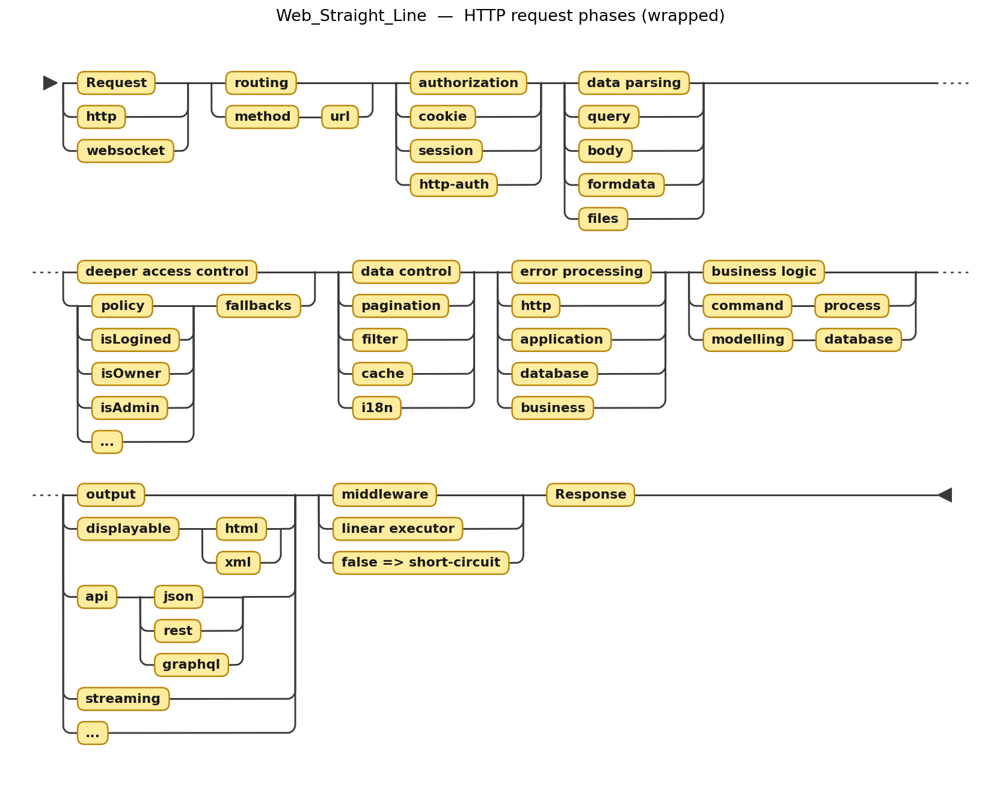
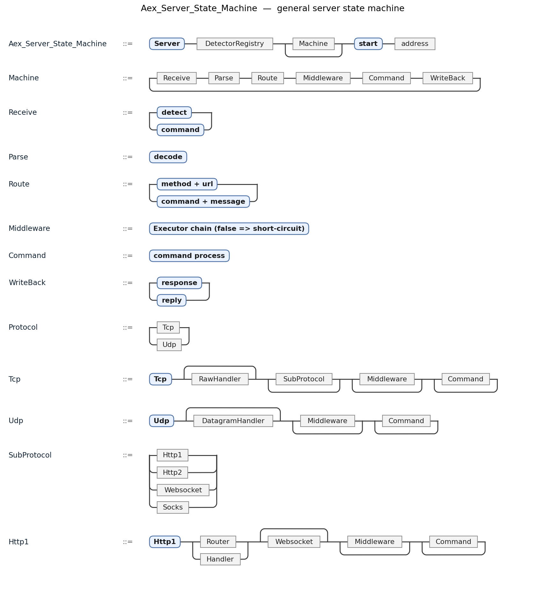

# Aex — Async-first, Executor-based Web/TCP/UDP Framework

[English](README.md) | **中文**

> 一个轻量、可控、忠于 HTTP 本质的 Rust 多协议框架

[](https://www.rust-lang.org)
[](LICENSE)
[](https://crates.io/crates/aex)
[](https://crates.io/crates/aex)
[](https://codecov.io/gh/Free-Web-Movement/aex)
[](https://github.com/Free-Web-Movement/aex/actions/workflows/rust.yml)
[](https://deps.rs/repo/github/Free-Web-Movement/aex)
[](https://discord.com/channels/823762790165774386/823762790165774389)

## 目录

- [Get Started (快速开始)](#get-started-快速开始)
- [版本](#版本)
- [核心特性](#核心特性)
- [设计哲学：包含 Web 直线的通用服务器状态机](#设计哲学包含-web-直线的通用服务器状态机)
  - [通用服务器状态机](#通用服务器状态机)
  - [Web 直线：状态机中 HTTP 分支的处理直线](#web-直线状态机中-http-分支的处理直线)
  - [各协议在同一状态机中的阶段映射（HTTP / WebSocket / TCP / UDP）](#各协议在同一状态机中的阶段映射http--websocket--tcp--udp)
  - [语法图：通用服务器状态机（包含 Web 直线）](#语法图通用服务器状态机包含-web-直线)
- [统一服务器架构](#统一服务器架构)
  - [支持的协议](#支持的协议)
  - [统一服务器 (Server)](#统一服务器-server)
  - [服务器启动模式](#服务器启动模式)
  - [协议宏详解（`tcp!` / `http!` / `udp!` / `ws!`）](#协议宏详解tcp--http--udp--ws)
  - [协议检测器体系（DetectorRegistry）](#协议检测器体系detectorregistry)
  - [Handler 类型签名](#handler-类型签名)
- [HTTP 快速开始](#http-快速开始)
  - [构建一个 Web 服务器](#构建一个-web-服务器)
  - [HTTP 路由详解](#http-路由详解)
  - [基于对象的路由方法（核心）](#基于对象的路由方法核心)
  - [HTTP/2 支持](#http2-支持)
  - [WebSocket 支持](#websocket-支持)
  - [静态文件服务](#静态文件服务)
- [http-server 静态服务器](#http-server-静态服务器)
  - [中间件](#中间件)
- [统一服务器 API](#统一服务器-api)
  - [适用场景](#适用场景)
- [TCP 协议](#tcp-协议)
  - [TCP 帧/命令定义](#tcp-帧命令定义)
- [UDP 协议](#udp-协议)
- [P2P：低层基础设施](#p2p低层基础设施)
  - [核心概念](#核心概念)
  - [命令 ID 定义](#命令-id-定义)
  - [连接状态机](#连接状态机)
  - [握手协议](#握手协议)
  - [心跳协议](#心跳协议)
- [通信器 (Communicators)](#通信器-communicators)
  - [Pipe - N:1 管道](#pipe---n1-管道)
  - [Spreader - 1:N 广播](#spreader---1n-广播)
  - [Event - M:N 事件系统](#event---mn-事件系统)
- [架构层面](#架构层面)
  - [多层架构设计](#多层架构设计)
  - [核心组件](#核心组件)
- [与其他框架对比](#与其他框架对比)
  - [协议支持对比](#协议支持对比)
  - [Aex 设计理念](#aex-设计理念)
  - [性能对比 (AEX vs Axum vs Actix-web)](#性能对比-aex-vs-axum-vs-actix-web)
  - [适用场景](#适用场景-1)
- [模块结构](#模块结构)
- [测试](#测试)
- [License](#license)
- [附录：Web 直线文法与图像（docs/grammar.md）](docs/grammar.md)

## Get Started (快速开始)

一条命令引入依赖：

```bash
cargo add aex
cargo add tokio --features full
```

**30 秒起一个 HTTP 服务**

```rust
use aex::http::router::Router as HttpRouter;
use aex::server::Server;
use aex::{_sync, http};

#[tokio::main]
async fn main() -> anyhow::Result<()> {
    let addr: SocketAddr = "0.0.0.0:8080".parse()?;
    let mut router = HttpRouter::default();

    router.get("/", _sync!(|_| "OK"));

    Server::default()
        .push(http!(router))
        .start(addr)
        .await?;
    Ok(())
}
```

**异步 handler 用 `_async!` 包一下即可**

```rust
use aex::http::router::Router as HttpRouter;
use aex::server::Server;
use aex::{_async, http};

#[tokio::main]
async fn main() -> anyhow::Result<()> {
    let addr: SocketAddr = "0.0.0.0:8080".parse()?;
    let mut router = HttpRouter::default();
    // 异步闭包：`_async!` 内部支持 await，同样免标注
    router.get("/", _async!(|ctx| {
        let html = fetch_home_page().await; // 任意 async 逻辑
        ctx.html(&html);
        true
    }));

    Server::default()
        .push(http!(router))
        .start(addr)
        .await?;
    Ok(())
}
```

**两种写法都是 `Arc<Executor>`，可在同一 router 上混用**

| | 同步 | 异步 |
|---|---|---|
| 宏名 | `_sync!`（主）、`now!`（别名） | `_async!`（主）、`then!`（别名） |
| 示例 | `_sync!(\|_\| "OK")` | `_async!(\|ctx\| { ...await... })` |
| 用途 | 纯同步 handler / 中间件 | 需要 `await` 的异步 handler / 中间件 |
| `ctx` 参数 | 免标注（泛型函数推断） | 免标注；不引用 ctx 时可写 `\|_\|` |
| 内部能否 `await` | 不能 | 可以 |
| 产物 | `Arc<Executor>` | `Arc<Executor>` |

>`_sync!` 通过泛型函数 `aex::http::types::sync` 恢复闭包参数推断，因此
>`|_| "OK"`、`|ctx| {...}` 无需写 `&mut Context` 标注；直接传给
>`router.get(...)`（走 `IntoExecutor`）则必须标注。

**路由即方法，一次挂载多个 URL（推荐）**

不再逐个手写 `router.get(...)` —— 路由直接写在方法上，`push` 一个实例，全部挂上：

```rust
use aex::http::router::Router as HttpRouter;
use aex::connection::context::Context;
use aex::http::meta::HttpMetadata;
use aex::http::protocol::header::HeaderKey;

struct User {
    name: String,
    api_key: String,
}

#[aex::routes]
impl User {
    // 一个属性：两个 URL；[auth] 是对象中间件，见下方同名方法
    #[get(["/", "/profile"], [auth])]
    fn profile(&self, ctx: &mut Context) {
        ctx.text(&self.name); // 直接用实例状态，无需全局变量
    }

    // async handler 同样支持
    #[post("/resources")]
    async fn create(&self, ctx: &mut Context) {
        ctx.text("created");
    }

    // 对象中间件：裸标识符 -> &self 方法，和 handler 看同一个 self
    fn auth(&self, ctx: &mut Context) -> bool {
        let key = HeaderKey::from_str("x-api-key").unwrap();
        ctx.get::<HttpMetadata>()
            .map(|m| m.headers.get(&key).is_some_and(|v| v == &self.api_key))
            .unwrap_or(false)
    }
}

let mut router = HttpRouter::default();
router.push(User {
    name: "aex".into(),
    api_key: "secret".into(),
});
```

> **`&self` 就是你的状态** —— 路由方法和对象中间件都天然持有同一个实例：不用闭包套闭包、不用全局变量、不用手动传参。

**`push` 收的是「实例」，不是「类型」** —— 两种写法都合法，取决于结构体怎么定义：

```rust
// ① 单元结构体（无字段）：类名即实例，直接 push 类名
struct Health;
#[aex::routes(prefix = "/backend")]
impl Health {
    #[get("/ping", no_prefix)]
    fn ping(ctx: &mut Context) -> &'static str { "pong" }
}
router.push(Health);                       // 构造零字段实例，等价于 push(Health {})

// ② 带字段结构体：必须显式构造实例，把状态一并传入
struct User { name: String, api_key: String }
#[aex::routes]
impl User {
    #[get("/me")]
    fn me(&self, ctx: &mut Context) { ctx.text(&self.name); }
}
router.push(User { name: "aex".into(), api_key: "secret".into() });
```

- 内部实现：`push` 收到的是**值**，`router.push<C: AexRoutes>(instance: C)` 会 `Arc::new(instance)`，宏生成的路由/中间件各自 `Arc::clone` 持有同一实例；`&self` 方法直接读该实例状态。
- 单元结构体 `struct Health;` 写 `push(Health)` 是**构造值**（零大小实例），不是传类型。
- 无状态需求 → 用单元结构体（省事）；需要共享状态（连接池、配置、计数器等）→ 定义字段并在 push 时传入。

**路由组前缀（`prefix`）** —— 一组路由共用一个前缀，适合按层级/子系统组织：

```rust
// #[aex::routes]               → 无前缀（根路径）
// #[aex::routes("/api")]       → 字符串字面量前缀
#[aex::routes(prefix = "/backend")]
impl BackendApi {
    // 属性里的路径与 prefix 拼接：/backend/admin/users
    #[get("/admin/users")]
    async fn users(ctx: &mut Context) { /* ... */ }

    // "/" 与 "" 双写法都可用：/backend/ 与 /backend 均可访问
    #[get(["/", ""])]
    async fn home(ctx: &mut Context) { /* ... */ }
}

let mut router = HttpRouter::default();
router.push(BackendApi);
```

- `#[aex::routes(prefix = "/...")]` 与 `#[aex::routes("/...")]` 两种写法等价；
- 前缀自动规范化（保证前导 `/`、去掉尾斜杠），属性路径原样拼接在后方；
- 空前缀（`#[aex::routes]`）等价于不加 prefix，路径保持不变；
- **个别路由可跳过前缀**：在路径属性里追加 `no_prefix` 标记，该路由按原样注册在根路径（`#[get("/health", no_prefix)]` → `/health`，而非 `/backend/health`）。

**`no_prefix` 与中间件不会混淆** —— 判定规则很明确：只看它是不是**属性里的直接位置参数**（裸标识符，不在 `[]` 内）：

| 写法 | 含义 |
|------|------|
| `#[get("/health", no_prefix)]` | `no_prefix` 是直接参数 → **跳过前缀**标记 |
| `#[get("/x", [auth], no_prefix)]` | 中间件数组在前、标记在后 → 既挂中间件又跳过前缀 |
| `#[get("/x", no_prefix, [auth])]` | 标记在前 → 跳过前缀 + 挂中间件 |
| `#[get("/x", [no_prefix])]` | 在 `[]` **数组内** → 是**中间件**（名为 `no_prefix`），前缀照常生效 |

> 结论：**裸的 `no_prefix` = 跳过前缀**；**`[no_prefix]` = 名为 no_prefix 的中间件**。两者靠「是否在数组内」区分，不会打架。
> 唯一要注意：若你的中间件恰好叫 `no_prefix`，请务必用 `[no_prefix]` 包裹，否则会被当成跳过前缀的标记。

```rust
#[aex::routes(prefix = "/backend")]
impl Demo {
    // 跳过前缀 → GET /ping（不带 /backend）
    #[get("/ping", no_prefix)]
    fn ping(ctx: &mut Context) -> &'static str { "pong" }

    // [no_prefix] 是中间件，前缀仍生效 → GET /backend/secure，先过 no_prefix 中间件
    #[get("/secure", [no_prefix])]
    fn secure(ctx: &mut Context) -> &'static str { "ok" }
}

// 全局中间件函数（名字恰好叫 no_prefix，必须用 [no_prefix] 包裹才生效）
fn no_prefix(ctx: &mut Context) -> bool { /* 鉴权逻辑 */ }
```

完整的 HTTP 路由、中间件、HTTP/2、WebSocket 用法见 [HTTP 快速开始](#http-快速开始)。

---

## 版本

当前版本: **0.1.23**

- 依赖配置见上方 [Get Started](#get-started-快速开始)。

## 核心特性

- **统一端口多协议** - HTTP/1.1、HTTP/2、WebSocket、TCP、UDP 共用同一端口，可插拔协议检测器体系
- **直觉的 HTTP 路由** - Trie 树路由，支持静态路径、参数路径、通配符
- **同步 / 异步 handler 双写法** - 同步闭包与 `_async!` 异步闭包统一由 `IntoExecutor` 接受，可混用
- **显式中间件链** - 线性执行顺序，可预测的控制流（非洋葱模型）
- **原生 WebSocket 支持** - 作为中间件自然集成，共享 HTTP 上下文
- **多协议支持** - HTTP/1.1、HTTP/2、TCP、UDP 服务器统一接口
- **TypeMap 扩展** - 灵活的请求/响应数据存储
- **端到端加密** - ChaCha20-Poly1305 会话加密
- **IPC 通信器** - Pipe、Spreader、Event 模式
- **自带 `http-server`** - `cargo install aex` 即得到一个开箱即用的静态文件服务器（nginx/apache 式），见 [http-server 静态服务器](#http-server-静态服务器)

---

## 设计哲学：包含 Web 直线的通用服务器状态机

Aex（Rust）是一台**通用服务器状态机**：以统一的「阶段化流程 + 线性中间件」处理**所有**协议
（HTTP / WebSocket / TCP / UDP）。

**Web 直线（The Web Straight Line）是专门描述 HTTP 请求 / 响应机制的理论，与其它协议无关**，
而且它是**无环（acyclic）**的：请求进、响应出，一条直线。
**它适用于所有「请求 → 响应」型的 HTTP 协议**（HTTP/1.1、HTTP/2，以及后续同类 HTTP）。
最早由 [`calidion/aex`](https://github.com/calidion/aex)
（[The Web Straight Line Theory](https://github.com/calidion/aex#what-is-the-web-straight-line)）提出。
在 aex 中，**Web 直线对应这台通用服务器状态机的 HTTP 分支——`Http1` 与 `Http2` 都在其中**：

> **不是「从 Web 直线扩展」。** aex 的通用服务器状态机**包含**（contains）Web 直线——
> Web 直线是它内部 HTTP 分支上那条无环的直线，而不是它的来源或母体。二者是「整体 ⊇ 部分」
> 的关系。完整 EBNF 与铁路图见 [`docs/grammar.md`](docs/grammar.md)。

### 通用服务器状态机（即 TCP / UDP 的处理逻辑）

通用服务器状态机的本质就是 **TCP / UDP 的处理逻辑**，它是一个**循环**：

```
接收（侦 / 命令）→ 解析 → 路由 → 中间件处理 → 命令处理 → 返回数据 → 新的循环 ↺
```

- **接收（侦 / 命令）**：接入连接 / 数据报，检测协议（**侦**）或读取**命令**。
- **解析**：编解码，把字节还原为帧 / 命令 / 请求。
- **路由**：HTTP 用 `method + url`；TCP/UDP 用 `command + message`。
- **中间件处理**：线性 `Executor` 链，返回 `false` 即短路。
- **命令处理**：业务逻辑（handler）。
- **返回数据**：回写响应 / 回复。
- **新的循环**：回到「接收」，继续处理下一个消息——这正是与 HTTP 最本质的差别。

**HTTP 是这条循环上的一个特例**：收到请求、返回数据即结束，不再回到接收——
这就是下面那条**无环**的 Web 直线。

### Web 直线：状态机中 HTTP 分支的无环直线

Web 直线就是上面状态机在 **HTTP 请求 / 响应**上的具体形态——**无环**，适用于所有请求→响应型 HTTP（HTTP/1.1、HTTP/2）：

```
请求开始 =》数据接收与存储/参数校验 =》身份校验 =》数据分析与处理 =》业务处理 =》数据发送 =》请求结束
```



一次 HTTP 请求沿这条直线**单向、顺序**地流过每个阶段。中间件插在阶段之间：先于 handler
执行，返回 `false` 即短路（等价于 `res.end`），请求终止——**不为已经结束的流程保留任何
"回来"的余地**。

**为什么不是洋葱模型**：主流中间件把线性的阶段硬塞进递归栈，并保留 `next` 回调，让控制流在
"进入"和"返回"两个方向上各走一遍。这与 HTTP 请求的真实形态并不一致，还错误地保留了本应
消失的回调、并要求为同一功能维护两套中间件。Web 直线拒绝这种模型。

**Web 直线（HTTP）本身的五条理念**（源自 `calidion/aex`）：

1. **分离 web 逻辑与业务逻辑**，只为 web 逻辑本身开发；
2. **专注于 web 流程**，不越界到业务领域；
3. **让写出好的 web 项目更简单**；
4. **把 web 交互看作一条直线**——即 Web 直线；
5. **不要 MVC**，聚焦于「web 逻辑」这一层架构。

### 各协议在同一状态机中的阶段映射（HTTP / WebSocket / TCP / UDP）

Web 直线只覆盖 HTTP 一列；状态机还包含其它协议分支，它们**共享同一套阶段与中间件语义**，
区别只在各阶段的具体实现：

| 阶段 | HTTP/1.1 | WebSocket | TCP | UDP |
|---|---|---|---|---|
| 接入 / 协议检测 | `Http11Detector` 认领 | HTTP `Upgrade` 后交给 `Websocket` 子处理器 | `Tcp` 兜底 | `Udp` 数据报槽位 |
| 路由 | method + url（Trie，参数/通配符） | 复用升级前的 HTTP 路径与 `router` | command + message（`Router` / `CommandRegistry`） | 按数据报的分发 key |
| 鉴权 | cookie · session · http-auth | 继承 HTTP 头 | 会话密钥 / 握手 | 会话密钥 / 握手 |
| 数据解析 | query · body · formdata · files | 帧（text / binary） | 帧 + 命令编解码 | 数据报解包 |
| 访问控制 / 数据控制 | 中间件链（线性 `Executor`） | 中间件链 | 中间件链 | 中间件链 |
| 业务逻辑 | route handler | `on_text` / `on_binary` | 命令 handler | 数据报 handler |
| 输出 | html / xml / json / streaming | WebSocket 帧 | 帧 | 数据报 |
| 结束 | 响应 + keep-alive | 关闭 / 升级完成 | 关闭 | 无连接（单包即止） |

要点：**同一个中间件链模型贯穿四者**——处理单元都返回 `bool`，`false` 即短路；
都**没有** `next` 回调，也都**不是**洋葱模型。WebSocket 只是「HTTP 升级后的中间件」，
TCP / UDP 则把「路由 / 鉴权 / 解析」换成命令与数据报的对应实现，其余阶段完全同构。

### Aex 如何落地这台状态机

- **显式线性中间件链**：处理器统一为 `Fn(&mut Context) -> BoxFuture<'_, bool>`（`Executor`），
  按注册顺序**线性**执行；返回 `false` 即短路。没有 `next`，没有洋葱模型。
- **Context 承载 scope 式数据**：阶段之间通过 `Context`（内含 TypeMap）传递数据，
  恰好对应状态机上的"数据接收与存储 → 数据分析与处理"。
- **No MVC**：路由不做成控制器层，而是用 `#[aex::routes]` 把路由声明在对象方法上，
  再由 `Router::push` 挂载——业务对象即路由载体。
- **WebSocket 是升级中间件**：WebSocket 只经 HTTP 升级触达，因此与 HTTP 共享上下文与路由，
  而不是被当成一种"特殊协议"。
- **可微服务、可全功能**：同一套状态机既能裁剪成微服务，也能通过组合协议/中间件扩展为
  全功能服务器。

### 语法图：通用服务器状态机（包含 Web 直线）

状态机写成文法：顶层只有 `Tcp`（流）与 `Udp`（数据报），HTTP / HTTP2 / WebSocket / SOCKS
都是 `Tcp` 的子处理器；**Web 直线是其中 HTTP 分支（`Http1` / `Http2`）内部的一条直线**。
完整 EBNF（可直接在 [Railroad Diagram Generator](https://bottlecaps.de/rr/ui) 渲染）见
[`docs/grammar.md`](docs/grammar.md)。



---

## 统一服务器架构

Aex 是目前 Rust 生态中**协议支持最全面**的 web 框架之一，可以在**同一个端口**同时运行多种协议。

### 支持的协议

| 协议类型 | 检测器 | 说明 |
|---|---|---|
| HTTP/1.1 | `Http11Detector` | 标准 HTTP 请求 |
| HTTP/2 | `Http2Detector` | HTTP/2 协议 preface |
| WebSocket | HTTP 升级请求内识别 | `Upgrade` 头 |
| HTTP 代理 | `Http11Detector` 内分流 | absolute-form / CONNECT（`feature = "proxy"`） |
| SOCKS4/4a/5 | `SocksDetector`（内置） | CONNECT 隧道（`feature = "proxy"`） |
| 自定义协议 | 自定义 `ProtocolDetector` | trojan / 私有协议 |
| TCP | 兜底 handler | 其他所有流量 |
| UDP | 独立 UDP Socket | 数据报通信 |

#### 内置 HTTP / SOCKS 代理（`feature = "proxy"`）

单端口同时承载多个服务，**由客户端首字节决定走哪条服务线**，无服务器端模式切换：

| 客户端行为 | 服务线 |
|---|---|
| `GET /path HTTP/1.1`（origin-form） | 网站路由 / handler |
| `GET http://host/path HTTP/1.1`（absolute-form） | HTTP 正向代理 → 上游 |
| `CONNECT host:port HTTP/1.1` | HTTP 隧道 → 上游 |
| `\x05\x01\x00...`（SOCKS 问候） | SOCKS4/4a/5 CONNECT |
| TLS ClientHello | 检测器认领 → 自定义 handler |

```bash
# Cargo.toml
aex = { version = "0.1", features = ["proxy"] }
```

```rust
use aex::connection::global::GlobalContext;
use aex::protocols::{proxy, socks};
use aex::proxy::ProxyAuthorizer;
use aex::server::Server;
use std::sync::Arc;

let authorizer: ProxyAuthorizer = Arc::new(|user, pass| user == "alice" && pass == "secret");

let server = Server::new(Arc::new(GlobalContext::new(addr, None)))
    // 同一个 HTTP/1.1 协议既服务网站（origin-form），也服务 HTTP 正向代理
    // （absolute-form / CONNECT），受同一套凭据约束。
    .push(proxy::http_proxy(None, Some(website), Some(authorizer.clone())))
    .push(socks::protocol(Some(authorizer)));
server.start(addr).await?;
```

- HTTP 代理：absolute-form 请求改写为 origin-form 后中继（剥离 hop-by-hop 头、注入 `Via`）；CONNECT 建隧道后原始字节双向转发。
- SOCKS 代理：仅 CONNECT（BIND / UDP ASSOCIATE 回“不支持”）；认证支持无认证与 RFC 1929 用户名/密码（`proxy_authenticator` 统一控制 HTTP 与 SOCKS 两端）。
- 默认不编译任何代理逻辑（开放代理是风险资产）；示例见 `examples/proxy_demo`。
- 测试：`cargo test --features proxy`（`tests/proxy_builtin_test.rs`：单端口网站+代理混跑、CONNECT 隧道、SOCKS4/4a/5、认证成败）。

### 统一服务器 (Server)

```rust
use aex::http::router::Router as HttpRouter;
use aex::server::Server;
use aex::{http, tcp_raw, udp, _async};
use std::net::SocketAddr;

#[tokio::main]
async fn main() -> anyhow::Result<()> {
    let addr: SocketAddr = "0.0.0.0:8080".parse()?;

    // HTTP 路由
    let mut http_router = HttpRouter::default();
    http_router.get("/", _async!(|ctx| { ctx.text("Hello from unified server!"); true }));

    // 创建统一服务器：顶层只挂 TCP / UDP，其余协议作为子处理器
    let server = Server::default()
        .push(tcp_raw!(
            |ctx| tokio::spawn(handle_tcp_connection(ctx)),
            http!(http_router)
        ))
        .push(udp!(|ctx| tokio::spawn(handle_udp_packet(ctx))));

    // 启动服务器 - 所有协议共享同一端口
    server.start(addr).await?;
    Ok(())
}
```
### 服务器启动模式

统一服务器的生命周期分三步：**构造 → 挂载协议 → 启动**。

#### 1. 构造：共享还是独立上下文

`GlobalContext` 承载跨连接的共享状态（连接管理器、事件总线、`PairedSessionKey`、业务注册的数据等）。

| 构造器 | 上下文 | 用途 |
|---|---|---|
| `Server::new(globals)` | **复用**传入的 `Arc<GlobalContext>` | 生产：与其他组件共享同一份全局状态 |
| `Server::default()` | **新建**独立 `GlobalContext`（含新 `PairedSessionKey`） | examples / tests：自成一体、不共享全局状态 |

**同一进程内要共享状态的服务器，必须用 `new` 传入同一个 `Arc<GlobalContext>`**；
只有“这台服务器不跟外界共享任何状态”时才用 `default()`。多台服务器各自 `default()`
会得到**互相隔离**的连接表、事件总线与 session key。监听地址不在此处绑定，而在启动时传入。

#### 2. 挂载：顶层挂 TCP / UDP（其它作为子处理器）

`push(protocol)`（原地版 `mount`）是唯一挂载入口。**推荐顶层挂 `Tcp` 兜底 + `Udp`**，
HTTP / HTTP/2 / WebSocket / 代理等作为 `Tcp` 的**子处理器**；只服务某一种流协议时，
也可把它直接 `push` 到顶层（此时没有非该协议的兜底）：

```rust
use aex::{http1, http2, tcp, udp};

// 多协议：必须用 `tcp!` 显式挂载各流协议；`http!` 是 web-only 的简化写法
Server::new(globals)
    .push(tcp!(http1!(router), http2!(router)))  // 顶层 TCP + HTTP/1.1 + HTTP/2
    .push(udp!());                               // 数据报协议
```

> **只开发 web（HTTP）服务器**时才用简化的 `http!(router)`（等价于
> `tcp!(http1!(router), http2!(router))`）；**一旦还要挂别的协议，必须用 `tcp!`**。

- `Tcp` 是流式兜底：检测层认领后，把连接交给能处理该协议的**子处理器**（HTTP → WebSocket）。
- `Udp` 进数据报槽位；`start(addr)` 会在后台为它起一个 UDP 接收循环。
- 带 `detector` 的协议挂载时自动把探测器登记进检测目录，通常无需手动 `.detector(...)`。

#### 3. 启动：`start(addr)`

| 方法 | 行为 |
|---|---|
| `.start(addr).await` | 绑定 `addr`，跑 TCP accept 循环；**若挂了 `Udp` 协议，同时在后台 `spawn` 一个 UDP 接收循环**。阻塞不返回。 |

```rust
Server::new(globals).push(http!(router)).start(addr).await?;   // 共享上下文
Server::default().push(http!(router)).start(addr).await?;      // 独立上下文
```

`start(addr)` 对 UDP 用 `tokio::spawn`，因此 TCP 主循环与 UDP 循环在**同一进程内并发**，
共用同一个端口号（TCP / UDP 端口彼此独立）。TCP 与 UDP 的协议处理完全由各自挂载的
协议处理器（`Tcp` / `Udp`）承担，Server 不再暴露单独的 `start_tcp` / `start_udp` 入口，
也不再提供 `at` / `solo` / `listen`。

### 协议宏详解（`tcp!` / `http!` / `udp!` / `ws!`）

内置协议宏是 `Struct::new(..).shared()` 的语法糖，把「构造 → 装箱为 `Arc<dyn Protocol>`
→ 挂载」压成一行，可直接 `Server::push`。它们全部 `#[macro_export]`，位于 crate 根：
`use aex::{http, tcp, udp};` 后即可直接写 `tcp!(…)`。

**展开对照总表**

| 宏 | 展开为 | 返回 |
|---|---|---|
| `tcp!()` | `Tcp::new(None).shared()` | `Arc<Tcp>` |
| `tcp!(sub, …)` | `Tcp::new(None).sub(sub)….shared()` | `Arc<Tcp>` |
| `tcp_raw!(h, sub, …)` | `Tcp::new(Some(Arc::new(h))).sub(sub)….shared()` | `Arc<Tcp>` |
| `http1!()` | `Http1::new(None, None).shared()` | `Arc<Http1>` |
| `http1!(router)` | `Http1::new(Some(Arc::new(router)), None).shared()` | `Arc<Http1>` |
| `http1!(handler: h)` | `Http1::new(None, Some(Arc::new(h))).shared()` | `Arc<Http1>` |
| `http1!(router, handler: h)` | `Http1::new(Some(..), Some(..)).shared()` | `Arc<Http1>` |
| `http1!(router, ws!(r2))` | `Http1::new(Some(..), None).with_websocket(ws!(r2)).shared()` | `Arc<Http1>` |
| `http2!(…)` | 与 `http1!(…)` **完全相同**的参数形式（router / `handler:` / `ws!`） | `Arc<Http2>` |
| `http!(…)` | **`tcp!(http1!(…), http2!(…))`**（完整性封装，见下） | `Arc<Tcp>` |
| `ws!()` / `ws!(r)` | `Arc::new(Websocket::new(None / Some(Arc::new(r))))` | `Arc<Websocket>` |
| `udp!()` / `udp!(h)` | `Udp::new(None / Some(Arc::new(h))).shared()` | `Arc<Udp>` |

> `.shared()` 就是 `Arc::new(self)`；`ws!` 直接返回 `Arc`，因为它只作为 HTTP 协议的参数。

**逐个解析**

- **`http!` — web-only 的简化入口。** 展开为 `tcp!(http1!(...), http2!())`：
  一次性给出**顶层 TCP 兜底 + HTTP/1.1 + HTTP/2**，你只需描述 HTTP 处理。
  **仅当只开发 web（HTTP）服务器时使用**；**要开发多协议（HTTP + TCP/UDP/…），必须用
  `tcp!` 显式组合**。并且 HTTP/1.1 与 HTTP/2 **共享同一个 `router` 和同一个 `ws!`
  子处理器**：
  - `http!(router)` ≡ `tcp!(http1!(router), http2!(router))`（同一个 router）
  - `http!(router, ws!(ws_router))` ≡ 两者共享这个 WebSocket 子处理器
  - `http!(handler: h)`、`http!(router, handler: h)`、`http!()` 同样把参数交给两个协议。
- **`http1!` / `http2!` — 裸协议。** 分别构造 `Http1` / `Http2`，参数形式**完全一致**
  （router、`handler:`、`ws!`）。`handler:` 优先于 `router`；`router` 机制两者相同。
  通常作为 `tcp!` 的子处理器显式组合：`tcp!(http1!(router), http2!(router))`。
  需要各自独立的 router 时才用裸协议（默认 `http!` 已让二者共享）。
- **`tcp!` — 顶层流式兜底。** TCP 是**唯一**的顶层流协议：HTTP/1.1、HTTP/2、WebSocket、
  SOCKS 都作为它的**子处理器**；未被任何子处理器认领的连接交给 `tcp!` 里可选的原始
  handler，没有则丢弃。子处理器的注册顺序即同层优先级。
  - `tcp!()`：无原始 handler，纯兜底。
  - `tcp!(sub, …)`：`Tcp::new(None).sub(sub)` 逐个追加子处理器（0 个或多个）。
- **`tcp_raw!(handler, sub, …)` — 带原始连接 handler 的 TCP。** 需要自己处理「谁都没认领」
  的裸连接时使用。`handler` 类型是 `Fn(Context) -> JoinHandle<()>`（接管 `Context`，
  通常 `tokio::spawn`）；其后可跟任意个子处理器。
- **`ws!` — WebSocket。** **从不单独挂载**：WebSocket 只经 HTTP 升级触达，因此只能作为
  `http!` / `http1!` / `http2!` 的参数传入。`ws!` 返回 `Arc<Websocket>`。
- **`udp!` — UDP 数据报。** `Udp` 是唯一的顶层数据报协议。每个数据报构造一个短生命周期
  `Context` 交给 handler；`None` 则丢弃。与 TCP 端口彼此独立、可同号并存。

**组合与嵌套规则**

```
// 只开发 web 服务器：用简化入口 http!
Server::push
 └─ http!(router)            顶层 TCP + HTTP/1.1 + HTTP/2（共享 router / ws!）
      └─ ws!(…)              WebSocket（经 HTTP 升级触达，只能在此层）

// 多协议：必须用 tcp! 显式组合
Server::push
 ├─ tcp!(http1!(router), http2!(router))   // 顶层 TCP（流）
 │    └─ ws!(…)                              // WebSocket 经 HTTP 升级触达
 └─ udp!( … )                                // 顶层数据报（唯一）
```

- **顶层只有两种协议**：`Tcp`（流）与 `Udp`（数据报）。
- **`http!` 只用于只开发 web 服务器**；`http!(router)` 已含顶层 `Tcp` 与 HTTP/1.1/HTTP/2。
- **要开发多协议（HTTP + TCP/UDP/…），必须用 `tcp!`**：
  `tcp!(http1!(router), http2!(router), …)`。
- WebSocket **不得**直接 `push`，必须嵌入 `http!` / `http1!` / `http2!`。
- 检测器随协议自动登记；`tcp!` 内子处理器顺序即优先级。

**常见错误**

| 写法 | 问题 | 正确写法 |
|---|---|---|
| `push(tcp!(http!(r)))` | `http!` 已含 `tcp!`，会重复嵌套 | `push(http!(r))` |
| `push(ws!(r))` | WebSocket 未挂在 HTTP 之下 | `push(http!(r, ws!(wr)))` |
| `http!(router, handler: h, ws)` | 参数顺序/形式不合法 | `http!(router, handler: h)` 或 `http!(router, ws!(wr))` |
| `tcp!(handler, …)` | `tcp!` 不接受位置 handler | 用 `tcp_raw!(handler, …)` |
| `udp!(handler)` 里 `await` 长任务 | 阻塞 UDP 接收循环 | `udp!(|ctx| tokio::spawn(...))` |

**配套的相关宏**

| 宏 | 作用 |
|---|---|
| `_async!` / `then!` | 把异步闭包封成 `Arc<Executor>` 处理器/中间件 |
| `_sync!` / `now!` | 把同步闭包封成 `Arc<Executor>`（如 `_sync!(\|_\| "OK")`） |
| `validator!` / `v!` | 由 DSL 构造校验中间件 |
| `frame!` / `command!` / `codec!` | 定义 TCP 帧/命令及其编解码实现 |
| `router!` | 由 extractor + 若干 handler 构造 TCP `Router` |
| `#[aex::routes]` | 在 `impl` 上声明 HTTP 路由，配合 `Router::push` 实例挂载 |

```rust
use aex::{http, http1, http2, tcp, udp};

// 多协议：用 `tcp!` 显式挂载各流协议（HTTP/1.1、HTTP/2），再加 UDP
Server::default()
    .push(tcp!(http1!(router), http2!(router)))       // 一个 TCP 兜底，下挂 HTTP/1.1 + HTTP/2
    .push(udp!(|ctx| tokio::spawn(handle_ctx(ctx))))  // 数据报
    .start(addr)
    .await?;

// 只开发 web（HTTP）服务器：用简化的 http!（等价 tcp!(http1!, http2!)）
// WebSocket 通过 HTTP 升级触达，因此传给 http!/http1!（而非单独挂载）
Server::default().push(http!(router, ws!(ws_router))).start(addr).await?;
```

### 协议检测器体系（DetectorRegistry）

协议识别不再是写死在服务器里的逻辑，而是一个**有序、可插拔、运行时可变**的检测器队列。
目录默认为空——HTTP/1.1、HTTP/2、WebSocket、trojan……所有协议检测器都由使用者
按需手动添加，顺序即优先级：

```rust
use aex::protocols::{http1::Http11Detector, http2::Http2Detector};
use aex::detect::{
    DetectorMode, DetectorRegistry, Position,
    ProtocolDetector, DetectionState, Verdict,
};

// 自定义检测器：实现 ProtocolDetector trait
struct TrojanDetector;

impl ProtocolDetector for TrojanDetector {
    fn name(&self) -> &str { "trojan" }
    fn protocol(&self) -> &str { "trojan" }

    fn detect(&self, buf: &[u8], _state: &mut DetectionState) -> Verdict {
        if buf.starts_with(b"\x16\x03\x01") {
            Verdict::Match                       // 认领连接
        } else if !buf.is_empty() {
            Verdict::Pass                        // 不匹配，交给下一个
        } else {
            Verdict::NeedMore(3)                 // 字节不够，再读一点
        }
    }
}

let server = Server::new(Arc::new(GlobalContext::new(addr, None)))
    .detector(Arc::new(TrojanDetector))          // 排在队首，先于 HTTP 判定
    .detector(Arc::new(Http2Detector))           // 内置组件同样可手动挂载
    .detector_at(Position::Front, Arc::new(Http11Detector))  // 指定插入位置
    .push(trojan_protocol);                      // 认领后的处理由挂载的 Protocol 负责
```

核心语义：

| 机制 | 说明 |
|------|------|
| **手动注册** | `detector()` 追加到队尾；`detector_at(Front / Back / Before(n) / After(n))` 自由排序 |
| **运行时增删** | `registry.register() / unregister() / replace()` 可在服务运行中调用；每条连接取快照检测，互不撕裂 |
| **冲突防护（双重）** | 注册时拒绝重名与 `conflicts_with` 声明冲突（双向检查）；运行期"首个 Match 获胜"短路后续检测器 |
| **状态标记 DetectorMode** | `Standard` 正常分发到对应 handler；`Forward` 标记有状态的直转型检测器——命中即终止全部检测，连接直接转发 |
| **链路状态 DetectionState** | 已缓冲字节数、认领结果+模式、逐检测器判定轨迹（history）、每检测器私有 scratch；分发后作为 ctx 属性随整条链路传递 |

`Verdict` 三态：`Match`（认领）/ `Pass`（不匹配）/ `NeedMore(n)`（数据不足，最多缓冲 16 KiB）。

#### 代理协议检测示例（examples/detectors_*）

核心只保留主流 Web 协议（HTTP/1.1、HTTP/2；HTTP/3/QUIC 后续加入）。TLS、SOCKS、
trojan、VLESS 等代理协议的检测器与验证中间件作为**开发示例**放在 examples 目录，
全部基于公开框架 API 组合，可直接运行、可作模板：

| 示例 | 内容 |
|------|------|
| `examples/detectors_common/mod.rs` | 共享实现：`TlsDetector`（ClientHello 被动解析，提取 SNI/ALPN）、`SocksDetector`（SOCKS4/5 问候识别）、`TlsLoader` + `TlsMiddleware::accept`（证书加载 + rustls TLS 终结）、`TrojanMiddleware::validate`、`VlessMiddleware::validate` |
| `examples/detector_tls/` | SNI/ALPN 路由：检测层认领 "tls"，按 ClientHello 名字分发 |
| `examples/detector_socks5/` | SOCKS5/SOCKS4 混合监听 |
| `examples/detector_trojan/` | 单端口 trojan-over-TLS 全链路：嗅探 → TLS 终结 → 头部校验剥离 |
| `examples/detector_vless/` | VLESS 结构校验（UUID 鉴权留待业务层） |

```bash
cargo test --test proxy_detectors_test   # 解析器单测 + 真实 socket 端到端
cargo run --example detector_trojan cert.pem key.pem
```

分层语义：

```text
原始字节 ──► 嗅探检测器（TlsDetector / SocksDetector / Http*）
                 │ 首个 Match 获胜
                 ▼
         custom_handler(protocol) 分发
                 ▼
 TlsMiddleware::accept(cert,key) ──► ctx 流变为解密后的明文
                 ▼
 Trojan/VLESS validate ──► 业务 handler / fallback
```

**边界说明**：VMess 与 Shadowsocks 的请求头在 UUID/PSK 派生密钥加密之下，被动字节
层面无法与随机流量区分，因此不存在"被动检测器"——支持它们需要持有用户库并做试解密
的完整协议中间件（应用层职责）。Clash 是客户端而非线上协议，无独立检测可言。
所有 validator 内置 10 秒读超时（`VALIDATION_TIMEOUT`），半包挂起的对端会被切断。

### Handler 类型签名

```rust
pub type HttpHandler = Arc<dyn Fn(&mut Context) -> BoxFuture<'_, bool> + Send + Sync>;
pub type Http2Handler = Arc<dyn Fn(&mut Context) -> BoxFuture<'static, bool> + Send + Sync>;

// TCP/UDP handler 接收 Context，可在 aex 体系中交换信息
pub type TCPHandler = Arc<dyn Fn(Context) -> JoinHandle<()> + Send + Sync>;
pub type UDPHandler = Arc<dyn Fn(Context) -> JoinHandle<()> + Send + Sync>;
```

---

## HTTP 快速开始

### 构建一个 Web 服务器

三步走：**建 Router → 注册路由 → 交给统一服务器（`Server`）启动**。
顶层只挂 TCP/UDP；HTTP 作为 TCP 的子处理器加载。

Handler 有两种形态，都是 `Arc<Executor>`，`IntoExecutor` trait 统一接受，可混用：
- **同步** `_sync!(|ctx| R)`（别名 `now!`）：免标注，不能 `await`；效果等价于直接传 `|ctx: &mut Context| R`；
- **异步** `_async!(|ctx| R)`（别名 `then!`）：内部可 `await`，免标注。

下面先看同步最简写法：

```rust
use aex::http::router::{NodeType, Router as HttpRouter};
use aex::server::Server;
use aex::{_sync, http};
use std::net::SocketAddr;

#[tokio::main]
async fn main() -> anyhow::Result<()> {
    let addr: SocketAddr = "0.0.0.0:8080".parse()?;
    let mut router = HttpRouter::default();

    router.get("/", _sync!(|_| "Hello, World!"));

    Server::default()
        .push(http!(router))
        .start(addr)
        .await?;
    Ok(())
}
```

需要 HTTP/2、WebSocket、TCP、UDP 共用同一端口时，`http!(router)` 已经默认同时开启
HTTP/1.1 与 HTTP/2（共享同一 router）；如需各自独立配置，可显式写
`tcp!(http1!(router), http2!(router2))`。

### HTTP 路由详解

> **同步与异步两种写法，本质是两种不同的 handler 类型**（由 `IntoExecutor` trait 统一接受）：
> - **同步** `_sync!(|ctx| R)`：R 为 `bool`/`()`/`String`/`&str`，免标注，不能 `await`
> - **异步** `_async!(|ctx| R)`：内部可 `await`，由 `_async!` 包装成 `Arc<Executor>`，免标注

```rust
use aex::http::router::{NodeType, Router as HttpRouter};
use aex::http::params::Params;
use aex::_sync;

// 1. 创建路由器
let mut router = HttpRouter::default();

// 2. 静态路由（同步闭包：_sync! 免标注）
router.get("/api/health", _sync!(|_| "OK"));

// 3. 参数路由（同步闭包）
router.get("/api/users/:id", _sync!(|ctx| {
    let params = ctx.local.get_ref::<Params>();
    if let Some(p) = params {
        let id = p.data.as_ref().and_then(|d| d.get("id").cloned());
        ctx.send(format!("User: {}", id.unwrap_or_default()), None);
    }
}));

// 4. 通配符路由（异步闭包：_async! 包装，内部可 await）
router.get("/api/files/*", _async!(|ctx| {
    let params = ctx.local.get_ref::<Params>();
    if let Some(p) = params {
        let path = p.data.as_ref().and_then(|d| d.get("*").cloned());
        ctx.send(format!("File: {}", path.unwrap_or_default()), None);
    }
    true
}));

// 5. 带中间件的路由（同步写法 + 链式中间件）
router.post("/api/users", _sync!(|ctx| {
    ctx.text("Created");
})).middleware(auth_middleware);
```

路由 handler 支持多种等价写法：直接返回字符串、`ctx.text(...)`/`ctx.json(...)`/`ctx.html(...)` 便捷方法、或原始 `ctx.send(content, mime)`：

```rust
// 同步写法：_sync! 免标注
router.get("/a", _sync!(|_| "Hello world!"));                       // 直接返回字符串
router.get("/b", _sync!(|ctx| { ctx.text("Hello"); }));             // 便捷方法，无需 true
router.get("/c", _sync!(|ctx| {                                     // 原始写法
    ctx.send("Hello world!", None);
    true
}));
```

> 若不用 `_sync!`，直接把同步闭包传给 `router.get(...)`（走 `IntoExecutor`）也等价，
> 只是必须标注参数类型：`|ctx: &mut Context| R`。

### 基于对象的路由方法（核心）

推荐方式：把**一个控制器 / 一个业务模块**写成一个 `struct`（类），路由是它的 `&self`
方法，中间件也是它的 `&self` 方法——handler 与中间件看到的是**同一个实例**，状态天然一致。

```rust
use aex::http::router::Router as HttpRouter;
use aex::connection::context::Context;

// 模块：一个承载路由与状态的实例（类）
struct User {
    name: String,
    db: String,      // 模拟依赖，真实项目里可以放连接池、配置等
}

#[aex::routes]
impl User {
    // 多路径 + 对象中间件；&self 方法可直接使用实例状态
    #[get(["/", "/profile"], [auth])]
    fn profile(&self, ctx: &mut Context) {
        ctx.text(&self.name);
    }

    // async handler
    #[post("/resources")]
    async fn create(&self, ctx: &mut Context) {
        ctx.text("created");
    }

    // 对象中间件：&self 方法，返回 bool（true 放行 / false 拦截）
    fn auth(&self, ctx: &mut Context) -> bool {
        // 用 self 上的配置/依赖做鉴权
        self.is_admin(ctx)
    }

    fn is_admin(&self, ctx: &mut Context) -> bool {
        let _ = ctx;
        self.name == "admin"
    }
}

let mut router = HttpRouter::default();
router.push(User { name: "aex".into(), db: "...".into() });
```

- 支持 `get`/`post`/`put`/`delete`/`patch`/`options`/`head`/`all` 属性。
- 第一个参数是路径：字符串，或字符串数组（`["/", "/profile"]`）；第二个参数是中间件数组。
- handler 支持 async 与同步，返回值遵循 `HandlerOutput`（`bool`/`()`/`String`/`&'static str`）。
- 被挂载的实例被捕获到每个路由闭包中，`&self` 方法可读写该实例的状态。
- `#[get]` 等属性只负责声明，真正的联结由 `router.push(实例)` 完成；push 收的是**实例**——单元结构体可直接写类名，带字段结构体须 `router.push(User { ... })`（详见 [push 收实例而非类型](#路由即方法一次挂载多个-url推荐)）。
- 没有 `&self` 的关联函数（`fn f(ctx: &mut Context)`）同样可以作为路由或中间件使用。
- 整组路由可加前缀：`#[aex::routes(prefix = "/backend")]`（或 `#[aex::routes("/backend")]`），块内所有路径自动拼接该前缀（详见 [路由组前缀](#路由即方法一次挂载多个-url推荐)）。

### HTTP/2 支持

HTTP/2 与 HTTP/1.1 共用同一个 router：

```rust
use aex::{http, http2, tcp};
use aex::http::router::{NodeType, Router as HttpRouter};
use aex::server::Server;
use std::net::SocketAddr;

Server::default()
    .push(http!(router)) // HTTP/1.1 + HTTP/2 共用同一 router
    .start(addr)
    .await?;
```

### WebSocket 支持

WebSocket 作为中间件实现，共享 HTTP 上下文：

```rust
use aex::http::websocket::{TextHandler, BinaryHandler};
use aex::http::middlewares::websocket::WebSocket;

let text_handler: TextHandler = Arc::new(|ws, ctx, text| {
    Box::pin(async move {
        println!("Received: {}", text);
        ws.send_text("pong").await;
        true
    })
});

let ws = WebSocket {
    on_text: Some(text_handler),
    on_binary: None,
};

router.get("/ws", _sync!(|_| true))
    .middleware(WebSocket::to_middleware(ws));
```

### 静态文件服务

一行注册，自动识别 MIME 类型，默认支持 html/css/js/json/图片等基本网站资源：

```rust
use aex::http::router::Router as HttpRouter;

let mut router = HttpRouter::default();
router.static_files("/static", "public");
// GET /static/app.js      -> public/app.js      (application/javascript)
// GET /static/img.png     -> public/img.png     (image/png)
// GET /static             -> public/index.html  (text/html)
```

- **自动 MIME**：按扩展名识别，覆盖 html/htm、css、js/mjs、json、txt/md、csv、xml、pdf、zip、wasm、png/jpg/gif/webp/svg/ico；未识别回退 `application/octet-stream`。文本类型（txt/md/html/css/csv）的 `Content-Type` 默认带 `charset=utf-8`。
- **目录列表**：目录无入口文件时生成 HTML 文件列表页（类似 `python -m http.server` / nginx autoindex），目录优先排序、显示文件大小、子目录可递归进入、父目录可返回。
- **目录重定向**：访问目录不带尾部斜杠时返回 301 到 `path/`（带 query 不丢失），保证相对链接解析正确，与 nginx/apache 行为一致。
- **递归目录**：前缀下的所有**子目录**都可访问（`/static/assets/img/...`）；目录请求优先回退到该目录的 `index.html`。
- **禁止越界**：`..` 路径段一律拒绝；并且每次访问都会解析符号链接校验目标仍位于根目录之内（symlink 无法绕出），永远无法访问根目录之外的任何文件。
- **大小上限**：默认 **100 MiB**，覆盖内网常见的几十 M 级文件下载；超限返回 404，防止超大文件拖垮服务器，更大的文件请走专门的下载服务。
- **自定义**：`static_files_with` 可调整上限与入口文件名：

```rust
use aex::http::static_files::StaticFiles;

router.static_files_with("/static", StaticFiles::new("public").max_file_size(5 * 1024 * 1024));
```

## http-server 静态服务器

`aex` 默认自带 `http-server` 二进制 —— 一个**开箱即用的 nginx/apache 式静态文件服务器**。只要 `cargo install aex`（或开发期 `cargo install --path .`），即可在任意目录直接发布 HTTP 静态资源站，无需写任何代码：

```bash
cargo install aex
http-server                 # 当前目录，端口 8080
http-server 3000            # 当前目录，端口 3000
http-server ./public        # 发布 ./public
http-server ./public 3000   # 发布 ./public，端口 3000
```

**当前能力**（与上面的 `Router::static_files` 完全一致）：

- 自动 MIME（文本类型带 `charset=utf-8`）
- 目录列表页：**文件类型专属图标**（目录=📁、Rust=🦀、Go=🐹、Python=🐍、Ruby=💎、C=🅲、TS=🔷、JS=🟨、HTML=🌐、CSS=🎨、图片=🖼️/🌅、文本=📄/📝、音频=🎵/🎼、视频=🎬/🎥、压缩包=📦/🗜️、PDF=📕、安装包=⚙️/🤖 等，几十种扩展名各不相同）+ 文件大小 + 目录优先排序
- 递归进入所有子目录、`..` 返回上级、目录 301 重定向补尾部斜杠
- 目录回退 `index.html`
- 禁止越界：`..` 段拒绝 + 符号链接解析校验，永远无法访问根目录之外的文件
- 单文件上限 100 MiB（超限 404，大文件走专门下载服务）
- **端口占用自动递增**：被占用则 +1 重试直到可用
- 启动打印本机 IPv4 地址，方便内网访问

**持续完善中**（对照 nginx/apache 的常用静态能力，按优先级推进）：

- [x] 目录列表页（autoindex）与文件类型图标
- [ ] 字节级 Range 请求（断点续传/视频拖动）
- [ ] 条件请求：`ETag` / `Last-Modified`（304 缓存协商）
- [ ] gzip/brotli 按内容协商压缩
- [ ] 隐藏文件（`.git` 等）默认不列出、可配置开关
- [ ] 自定义 404 页面
- [ ] 目录索引页模板自定义 / 排序方式配置
- [ ] `index` 多入口回退（index.html → index.htm → default.htm）
- [ ] 上传功能（可选开启）
- [ ] `--auth` 简单 Basic Auth 保护
- [ ] `--prefix` 指定发布前缀、`--host` 绑定网卡

> 以上能力在 `Router::static_files_with` + `StaticFiles` 配置项上同步演进，库与二进制保持一致。

### 中间件

中间件是处理链上的一环，位于 handler 之前，按声明顺序线性执行。它的本质就是一个 `Executor`：

```rust
pub type Executor = dyn for<'a> Fn(&'a mut Context) -> BoxFuture<'a, bool> + Send + Sync;
```

- 返回 `true` → 放行，继续下一个中间件 / handler
- 返回 `false` → 拦截，请求终止（状态码默认 400，可先用 `ctx.status(...)` 覆盖）

有两种写法，对应两种需求：
- **函数式（无状态）**：闭包、自由函数、可复用的 `Arc<Executor>`，见下文前几节；
- **对象式（有状态）**：`&self` 方法，能直接拿到实例的 `self`，见 [对象中间件](#对象中间件把-self-带进中间件)。

#### 写一个最简单的中间件（同步）

```rust
use aex::connection::context::Context;
use aex::http::protocol::status::StatusCode;

let auth = _sync!(|ctx| {
    if ctx.req().query("token").as_deref() == Some("secret") {
        true
    } else {
        ctx.status(StatusCode::Unauthorized).text("forbidden");
        false
    }
});
```

#### 异步中间件：用 `_async!` 即可

```rust
let rate_limiter = _async!(|ctx| {
    // 任意 async 逻辑：查库、计数、IO……
    true
});
```

#### 同步 vs 异步：写法差异一览

| | `_sync!(\|ctx\| { ... })` / `now!(...)` | `_async!(\|ctx\| { ... })` / `then!(...)` |
|---|---|---|
| 用途 | 纯同步 handler / 中间件 | 需要 `await` 的异步 handler / 中间件 |
| `ctx` 参数 | 免标注（泛型函数推断） | 免标注；不引用 ctx 时可写 `\|_\|` |
| 返回值 | 直接返回 `bool`/`()`/`String`/`&str` | 返回 `bool`（可省略，body 内 await 后返回 true） |
| 内部能否 `await` | 不能 | 可以（查库 / IO / 调用 async fn） |
| 产物类型 | `Arc<Executor>` | `Arc<Executor>` |
| 使用位置 | `.middleware(...)` / `router.get(...)` | 与同步完全一致，可混排 |

> 免标注是 `_sync!`/`_async!` 独有的便利：`_sync!` 通过泛型函数 `aex::http::types::sync`
> 恢复闭包参数推断。若把同步闭包**直接**传给 `router.get(...)`（走 `IntoExecutor`），
> 则必须标注 `|ctx: &mut Context|`——效果等价，只是多写几个字。

**一句话**：同步用 `_sync!`（或别名 `now!`），需要 `await` 就用 `_async!`（或别名 `then!`），两个都是 `Arc<Executor>`，同一路由的中间件链可以**同步 + 异步混排**：
`.middleware(_sync!(auth)).middleware(_async!(async_log))`。

#### 中间件能做什么

- **读请求**：`ctx.req().method()` / `.param("id")` / `.query("token")` / `.form("name")`，或 `ctx.local.get_ref::<HttpMetadata>()` 读取请求头与元数据
- **写响应**：`ctx.text()` / `ctx.json()` / `ctx.html()` / `ctx.send()`、`ctx.status(...)`、`ctx.redirect(url)`
- **传状态**：`ctx.set(data)` / `ctx.get::<T>()` 在中间件与 handler 之间共享数据

#### 两种使用场景，中间件形式不同

##### 场景一：链式 API（`router.get` / `.middleware(...)`）

链式 API 没有 `self` 上下文，中间件**只接受全局函数**和**匿名闭包**（返回 `Arc<Executor>`）：

```rust
use aex::connection::context::Context;
use aex::http::types::IntoExecutor;

// 匿名闭包（同步 / 异步均可）
router.get("/x", _sync!(|_| true)).middleware(_sync!(|ctx| {
    // 同步逻辑
    true
}));
router.get("/x", _async!(|_| { true })).middleware(_async!(|ctx| {
    do_async().await;
    true
}));

// 全局函数
fn auth(ctx: &mut Context) -> bool {
    ctx.req().header("x-api-key").is_some()
}
router.get("/secret", handler).middleware(auth);

// 配置构建器
router.get("/x", handler).middleware(RateLimitConfig::new(100, 60).by_ip().build());
```

`router.get_with(...)` / `router.post_with(...)` 等内联写法同样只接受 `Arc<Executor>`：

```rust
router.get_with("/x", [_sync!(|_| true), auth], |_ctx: &mut Context| true);
```

##### 场景二：属性宏（`#[get]` / `#[post]` / ...，在 impl 块内）

属性宏的中间件数组有**更丰富的解析能力**——因为宏知道 impl 块里有哪些方法：

| 写法 | 分类 | 查找顺序 |
|------|------|----------|
| `self.auth` | SelfMethod | 强制实例方法（`&self`，返回 `bool`）；找不到 → 编译报错 |
| `auth` | BareIdent | 级联：① self 方法（`&self`，`→ bool`）→ ② 关联函数（无 self，`→ bool`）→ ③ 全局函数（仅同步） |
| `_sync!(...)` / `_async!(...)` | Expr | 经 `IntoExecutor` 转换，与链式 API 等价 |
| `logger!()` / `v!(...)` | Expr | 内置中间件，同上 |

```rust
struct Api {
    api_key: String,
}

#[aex::routes]
impl Api {
    // self.auth → 显式实例方法
    #[get("/admin", [self.auth])]
    fn admin(&self, ctx: &mut Context) {
        ctx.text("admin-only");
    }

    // auth → 级联：先找 self.auth（找到，走实例方法）
    #[get("/secret", [auth])]
    fn secret(&self, ctx: &mut Context) {
        ctx.text("secret-ok");
    }

    // global_auth → 级联：不在 impl 块 → 全局函数
    #[get("/public", [global_auth])]
    fn public(&self, ctx: &mut Context) {
        ctx.text("public-ok");
    }

    // check → 级联：找关联函数 check（无 self，返回 bool）
    #[get("/checked", [check])]
    fn checked(&self, ctx: &mut Context) {
        ctx.text("checked-ok");
    }

    // 实例方法
    fn auth(&self, ctx: &mut Context) -> bool { /* ... */ }

    // 关联函数（无 self）
    fn check(ctx: &mut Context) -> bool { /* ... */ }
}

// 全局函数
fn global_auth(ctx: &mut Context) -> bool { /* ... */ }
```

**关键区别**：
- 链式 API 没有 `self` 上下文，实例方法无法调用 → 只有全局函数 + 闭包。
- 属性宏知道 impl 块的方法列表，所以支持**实例方法**和**关联函数**的级联查找。
- 裸标识符 `auth` 在属性宏里是**级联查找**（self → 关联 → 全局），在链式 API 里如果传一个函数名就直接走 `IntoExecutor`（无级联）。

#### 挂载

两种方式最终都走 `Router::push(instance)`：

```rust
// 链式：中间件通过 .middleware() 追加
router.get("/x", _sync!(|_| true)).middleware(auth);
router.get_with("/x", [_sync!(|_| true), rate_limiter], |_ctx: &mut Context| true);

// 属性宏：路由 + 中间件在 #[get/post] 里声明，router.push(instance) 一次性挂载
#[get(["/", "/profile"], [self.auth, RateLimitConfig::new(100, 60).build()])]
```

`post_with`/`put_with`/`delete_with`/`patch_with`/`options_with`/`head_with`/`all_with`
提供同样的内联写法。

> 注意：属性宏生成的注册代码在 `impl` 块作用域内，所以中间件数组只能引用**实例方法**、
> **关联函数**、**全局函数**，以及 **模块级条目**（自由函数、`logger!()`/`v!(...)` 宏调用、
> `RateLimitConfig::new(...).build()` 等自包含表达式），不能引用 `main`/闭包内的局部变量。

#### 内置中间件

| 中间件 | 说明 | 使用 |
|--------|------|------|
| `logger!()` | 请求日志 | `logger!()` |
| `v!(...)` | DSL 参数校验 | `v!(name => "required")` |
| `RateLimitConfig` | 限流（按 IP / 头 / 路径） | `RateLimitConfig::new(100, 60).by_ip().build()` |
| `CorsConfig` | 跨域 | `CorsConfig::new().allow_origin_all(true).build()` |
| `WebSocket` | WebSocket 升级 | `WebSocket::to_middleware(ws)` |

#### 投资少，回报大，一劳永逸

- 契约自框架诞生至今**没有变过**：一个 `Executor`、一个 `bool`，两条规则。
- 函数式与对象式中间件**共用同一契约**，写一次，链式 / 内联 / 属性宏**三种挂载全部通用**，无需为每种写法适配。
- 没有 tower/layer、没有 extractor、没有 rejection——**不需要学习任何额外抽象**，会写闭包、会写方法就会写中间件。
- 中间件只依赖稳定的 `Context` 与可选的 `&self`，不受路由 API 演进影响，写完可长期复用、跨项目搬运。

---

## 统一服务器 API

| 方法 | 说明 |
|------|------|
| `.new(globals)` / `Server::default()` | 构造（共享上下文 / 独立上下文） |
| `.push(protocol)` | 挂载一个实现了 `Protocol` 的协议（HTTP / HTTP2 / WebSocket / TCP / UDP / 自定义） |
| `.mount(protocol)` | 同 `push`，以 `&mut self` 形式挂载 |
| `.detector(d)` / `.detector_at(pos, d)` | 注册协议检测器（队尾 / 指定位置） |
| `.with_registry(registry)` | 共享外部管理的检测器目录（运行时增删） |
| `.detection(bool)` | 开关检测阶段；关闭后连接直接进默认 TCP 处理器，不嗅探 |
| `.start(addr)` | 启动统一服务器 |

> 推荐的顶层处理器是 `Tcp`（流）与 `Udp`（数据报）；HTTP、HTTP/2、WebSocket 等通常作为
> `Tcp` 的子处理器（用宏写作 `http!(router)`）。只服务流协议时也可直接 `push(http!(router))`。

> 连接属性：统一服务器在分发前把 `ConnectionFd`（原始文件描述符）写入 ctx，
> split 后的读写半部仍可做 fd 级操作（如原目的地址 `SO_ORIGINAL_DST` 查询）。

### 适用场景

| 场景 | 使用的协议 |
|------|----------|
| REST API | HTTP/1.1, HTTP/2 |
| 实时聊天 | HTTP/1.1 + WebSocket, HTTP/2 + WebSocket |
| 游戏服务器 | TCP/UDP |
| 物联网网关 | HTTP + TCP + UDP |
| 实时推送 | HTTP + SSE |

---

## TCP 协议

```rust
use aex::bytes::Bytes;
use aex::tcp::router::Router as TcpRouter;
use futures::FutureExt;

// 1. 创建 TCP 路由器并安装字节级 extractor。
//    extractor 签名: Fn(&[u8]) -> anyhow::Result<Option<(usize, u32, Bytes, Bytes)>>
//      Ok(Some((已消费字节数, 分发 key, frame 字节, command 字节))) —— 解析出一个完整帧
//      Ok(None) —— 半包/不够，等待更多字节
//      Err(..)  —— 解析成功但校验失败，说明不是本协议（由 GlobalContext 的策略决定丢弃或断连）
let mut tcp_router = TcpRouter::new().extractor(|buf: &[u8]| {
    // 在这里把 buf 解析为 (consumed, key, frame_bytes, cmd_bytes)
    Ok(None)
});

// 2. 注册处理器（命令 ID = 1）。handler 直接收 Bytes，自行 parse。
tcp_router.on(
    1,
    Box::new(|_ctx, _frame: Bytes, _cmd: Bytes| async move { Ok(true) }.boxed()),
    vec![],
);
```

> 路由器本身**不含任何业务类型**：收发的都是 `Bytes`。协议的编解码（`Bytes → Codec →
> Frame/Command`）由 extractor 与 handler 完成。

### TCP 帧/命令定义

```rust
use aex::tcp::types::{Codec, Command, Frame};
use serde::{Deserialize, Serialize};
use bincode::{Decode, Encode};

#[derive(Clone, Debug, Serialize, Deserialize, Encode, Decode)]
struct MyFrame {
    data: Vec<u8>,
}

impl Frame for MyFrame {
    fn payload(&self) -> Option<Vec<u8>> { Some(self.data.clone()) }
    fn validate(&self) -> bool { true }
    fn command(&self) -> Option<&Vec<u8>> { Some(&self.data) }
    fn is_flat(&self) -> bool { false }
}

#[derive(Clone, Debug, Serialize, Deserialize, Encode, Decode)]
struct MyCommand {
    id: u32,
    data: Vec<u8>,
}

impl Command for MyCommand {
    fn id(&self) -> u32 { self.id }
    fn data(&self) -> &Vec<u8> { &self.data }
}
```

---

## UDP 协议

```rust
use aex::bytes::Bytes;
use aex::udp::router::Router as UdpRouter;

// 创建 UDP 路由器并安装 extractor。
//   extractor 签名: Fn(&[u8]) -> anyhow::Result<Option<(u32, Bytes, Bytes)>>
//     每个数据报即一条完整消息，返回 (分发 key, frame 字节, command 字节)。
let mut udp_router = UdpRouter::new().extractor(|buf: &[u8]| {
    // 解析 buf 得到 (key, frame_bytes, cmd_bytes)，解不出则 Ok(None)
    Ok(None)
});

// 注册处理器（handler 直接收 Bytes，自行 parse）
udp_router.on(100, |_global, _frame: Bytes, _cmd: Bytes, addr, _socket| {
    Box::pin(async move {
        println!("UDP packet from {}", addr);
        Ok(true)
    })
});
```

---

## P2P：低层基础设施

> **P2P 不是协议，而是一种低层基础设施 / 服务能力**：它面向节点（node），提供 NAT 穿透、
> 握手、连接管理等通用能力，供上层服务复用。它不占协议分支，也不出现在
> [通用服务器状态机](#设计哲学包含-web-直线的通用服务器状态机)的协议列表里。

Aex 内置基于 **IP 识别** 的 P2P 基础设施，支持去中心化网络通信。

### 核心概念

```
┌─────────────────────────────────────────────────────────────┐
│                      P2P 节点                               │
├─────────────────────────────────────────────────────────────┤
│  Node {                                                    │
│    id: Vec<u8>,      // 节点 ID，通常是公钥哈希               │
│    version: u8,     // 协议版本                             │
│    started_at: u64, // 启动时间戳                           │
│    port: u16,       // 监听端口                             │
│    protocols: HashSet<Protocol>,  // 支持的协议列表          │
│    ips: Vec<(NetworkScope, IpAddr)>,  // 网络地址列表        │
│  }                                                         │
└─────────────────────────────────────────────────────────────┘
```

### 命令 ID 定义

| CommandId | 值 | 说明 |
|----------|-----|------|
| Hello | 1 | 握手请求 (含节点信息) |
| Welcome | 2 | 握手响应 (接受/拒绝) |
| Ack | 3 | 确认握手完成 |
| Reject | 4 | 拒绝连接 |
| Ping | 5 | 心跳请求 |
| Pong | 6 | 心跳响应 |

```rust
use aex::connection::commands::CommandId;

assert_eq!(CommandId::Hello.as_u32(), 1);
assert_eq!(CommandId::Pong.as_u32(), 6);
```

### 连接状态机

```
┌─────────────────────────────────────────────────────────────┐
│              连接状态机 (ConnectionStateMachine)              │
├─────────────────────────────────────────────────────────────┤
│  Initial ──→ Connecting ──→ Handshake ──→ Established        │
│     │           │              │              │             │
│     │           │              │              ↓             │
│     │           │              │         Active             │
│     │           │              │              │             │
│     │           │              │              ↓             │
│     │           │              └─────── Disconnecting        │
│     │           │                         │                  │
│     │           └─────────────────→ Disconnected             │
│     │                          ↑                               │
│     └──────────────────────────┘                              │
└─────────────────────────────────────────────────────────────┘
```

```rust
use aex::connection::state_machine::{ConnectionStateMachine, ConnectionState};

let sm = ConnectionStateMachine::new();
sm.transition(ConnectionState::Connecting);
sm.transition(ConnectionState::Handshake);
sm.transition(ConnectionState::Established);
sm.transition(ConnectionState::Active);

assert!(sm.is_active());
assert!(sm.should_heartbeat());
```

### 握手协议

```
┌─────────────────────────────────────────────────────────────┐
│                   P2P 握手流程                          │
├─────────────────────────────────────────────────────────────┤
│   Client                                Server               │
│     │                                     │                 │
│     │───────── CMD_HELLO ─────────────────→│                 │
│     │  (version, node, ephemeral_pub)      │                 │
│     │                                     │                 │
│     │←──────── CMD_WELCOME ────────────────│                 │
│     │  (version, node, accepted, pub)     │                 │
│     │                                     │                 │
│     │───────── CMD_ACK ─────────────────→│                 │
│     │  (accepted, session_key_id?)        │                 │
│     │                                     │                 │
│     │         [加密通道建立]                │                 │
└─────────────────────────────────────────────────────────────┘
```

### 心跳协议

```rust
use aex::connection::heartbeat::{HeartbeatManager, HeartbeatConfig};

let config = HeartbeatConfig::new()
    .with_interval(30)   // 30秒间隔
    .with_timeout(10)     // 10秒超时
    .on_timeout(|addr| {
        println!("连接超时: {}", addr);
    })
    .on_latency(|addr, latency| {
        println!("延迟 {} ms", latency);
    });

let manager = HeartbeatManager::new(local_node).with_config(config);
```

---

## 通信器 (Communicators)

### Pipe - N:1 管道

多个发送者 → 一个消费者（适用于日志、审计）：

```rust
use futures::FutureExt;

server.globals.pipe::<String>("audit_log", Box::new(|msg| {
    async move { write_to_file(msg).await }.boxed()
})).await;

server.globals.pipe.send("audit_log", "User logged in".to_string()).await;
```

### Spreader - 1:N 广播

一个发送者 → 多个消费者（适用于配置同步）：

```rust
use futures::FutureExt;

server.globals.spread::<i32>("config_sync", Box::new(|val| {
    async move { update_config(val).await }.boxed()
})).await;

server.globals.spread.publish("config_sync", 42).await;
```

### Event - M:N 事件系统

多个发送者 → 多个消费者（适用于业务事件）：

```rust
use aex::communicators::event::Event;
use futures::FutureExt;

server.globals.event::<u32>("user_login", Arc::new(|uid| {
    async move { notify_admins(uid).await }.boxed()
})).await;

Event::<u32>::notify(&server.globals.event, "user_login".to_string(), 888).await;
```

---

## 架构层面

### 多层架构设计

```
┌─────────────────────────────────────────────────────────────┐
│                    Application Layer                       │
│  ┌─────────────────────────────────────────────────────┐   │
│  │              Executor Chain                         │   │
│  │  [Middleware 1] → [Middleware 2] → [Handler]       │   │
│  └─────────────────────────────────────────────────────┘   │
├─────────────────────────────────────────────────────────────┤
│                      Router Layer                           │
│  ┌──────────────┐ ┌──────────────┐ ┌──────────────┐         │
│  │ HTTP Router │ │ TCP Router   │ │ UDP Router   │         │
│  │  (Trie)     │ │  (Map)       │ │  (Map)       │         │
│  └──────────────┘ └──────────────┘ └──────────────┘         │
├─────────────────────────────────────────────────────────────┤
│                    Protocol Layer                           │
│  ┌──────────────┐ ┌──────────────┐ ┌──────────────┐         │
│  │ HTTP/1.1     │ │ HTTP/2       │ │ TCP Frame    │         │
│  │ WebSocket    │ │ WebSocket    │ │ Codec        │         │
│  └──────────────┘ └──────────────┘ └──────────────┘         │
│  ┌──────────────┐                                           │
│  │ UDP Packet   │                                           │
│  └──────────────┘                                           │
├─────────────────────────────────────────────────────────────┤
│                    Transport Layer                          │
│  ┌──────────────────────────────────────────────────┐        │
│  │ Unified TCP Listener (Protocol Detection)        │        │
│  │ + UDP Socket                                       │        │
│  └──────────────────────────────────────────────────┘        │
└─────────────────────────────────────────────────────────────┘
```

### 核心组件

| 组件 | 职责 | 特点 |
|------|------|------|
| **Server** | 统一多协议入口 | HTTP/TCP/H2 共享端口 |
| **Router** | 路由匹配 | Trie 树 / HashMap |
| **Executor** | 处理器 | BoxFuture 异步 |
| **Context** | 请求上下文 | TypeMap 存储 |
| **ConnectionManager** | 连接池 | DashMap 并发 |
| **GlobalContext** | 全局共享状态 | 跨连接通信 |
| **SessionKeyManager** | 加密会话管理 | 端到端加密 |
| **Pipe** | N:1 消息管道 | 日志/审计 |
| **Spreader** | 1:N 广播 | 配置同步 |
| **Event** | M:N 事件系统 | 事件通知 |

---

## 与其他框架对比

### 协议支持对比

| 协议 | Aex | Axum | Actix-web |
|------|-----|------|----------|
| HTTP/1.1 + WebSocket | ✅ | ✅ | ✅ |
| HTTP/2 + WebSocket | ✅ | ✅ | ✅ |
| **统一端口多协议** | ✅ | ❌ | ❌ |
| TCP 自定义 | ✅ | ❌ | ❌ |
| UDP | ✅ | ❌ | ✅ |
| mDNS | ✅ | ❌ | ❌ |

### Aex 设计理念

  1. **显式优于隐式** - 线性中间件链，控制流可预测
  2. **轻量优于重** - 最少依赖，直面核心问题
  3. **性能优先** - ahash + Trie 树优化
  4. **HTTP 本质** - 尊重 HTTP 协议设计
  5. **统一架构** - 同一端口支持所有协议

### 性能对比 (AEX vs Axum vs Actix-web)

wrk 基准测试 (release 构建, `t4-c500` 高并发 5s):

| 路由 | AEX QPS | Axum 0.8.9 QPS | Actix-web 4 QPS | AEX vs Axum | AEX vs Actix |
|------|---------|-----------------|-----------------|-------------|-------------|
| `/` | 130,455 | 118,448 | 141,612 | **1.10x** | 0.92x |
| `/api/users` | 132,157 | 114,872 | 128,422 | **1.15x** | **1.02x** |
| `/api/users/{id}` | 116,345 | 97,831 | 110,414 | **1.18x** | **1.05x** |

AEX 在静态和动态路由上均优于 Axum，动态参数路由优势最大 (1.18x)。与 Actix-web 相比，AEX 在带路径参数的路由上表现更好。

### 适用场景

- 高性能 API 服务
- WebSocket 应用
- TCP/UDP 混合服务
- 微服务架构
- 资源受限环境

---

## 模块结构

```
aex/
├── protocols/          # 全部协议处理器（`Protocol` trait 实现）
│   ├── http/           # HTTP/1.1 框架
│   │   ├── router.rs   # Trie 树路由器
│   │   ├── types.rs    # Executor 类型定义
│   │   ├── meta.rs     # HTTP 元数据
│   │   ├── req.rs      # 请求解析
│   │   ├── res.rs      # 响应处理
│   │   ├── params.rs   # 路径/查询/表单参数
│   │   ├── websocket.rs# WebSocket 帧
│   │   ├── macros.rs   # HTTP 方法宏 / validator!
│   │   └── middlewares/# 内置中间件（cors/logger/rate_limit/validator/websocket）
│   ├── http1.rs        # Http1 协议（HTTP/1.1 + 默认 WebSocket 子处理器）
│   ├── http2/          # HTTP/2
│   │   ├── mod.rs      # H2Codec 编解码器
│   │   └── protocol.rs # Http2 协议
│   ├── tcp/            # TCP
│   │   ├── protocol.rs # Tcp 协议 + router_handler/from_handler
│   │   ├── router.rs   # 命令路由器（extractor + handler）
│   │   ├── types.rs    # Frame/Command trait
│   │   ├── listeners.rs# TCP 监听器
│   │   └── macros.rs   # frame!/command!/codec!/router!
│   ├── udp/            # UDP
│   │   ├── protocol.rs # Udp 协议
│   │   ├── router.rs   # 数据包路由器
│   │   └── types.rs    # UDP 类型
│   ├── websocket.rs    # WebSocket 协议（HTTP 升级中间件形态）
│   ├── socks.rs        # SOCKS4/5 协议（feature = "proxy"）
│   ├── proxy.rs        # proxy 协议入口
│   └── classify.rs     # 协议分类辅助（HTTP 方法、H2 前言…）
│
├── p2p/                # P2P 低层基础设施（NAT 穿透等，非协议）
│   └── nat/            # NAT 穿透（传输层以下，直接操作 socket）
│       ├── client.rs   # 客户端/隧道
│       ├── server.rs   # 中继服务
│       ├── punch.rs    # 打洞协调
│       ├── service.rs  # NatDetector + unified 服务注册
│       └── types.rs    # 帧/错误类型
│
├── server.rs           # 统一服务器 ⭐（Server::push/start）
├── protocol.rs         # Protocol trait + Transport（协议统一接口）
├── detect.rs           # 可插拔协议检测器体系（注册/排序/冲突防护）
├── handler.rs          # ProtocolHandler / CommandRegistry / HandlerState
│
├── connection/         # 连接管理
│   ├── context.rs      # Per-request Context
│   ├── global.rs       # 全局上下文（含 FrameErrorPolicy）
│   ├── manager.rs      # 连接池管理
│   └── types.rs        # 连接类型
│
├── crypto/             # 加密支持
│   └── session_key_manager.rs  # X25519 + ChaCha20Poly1305
│
├── communicators/      # IPC 模式
│   ├── spreader.rs     # Pub/Sub 广播
│   ├── event.rs        # 事件系统
│   └── pipe.rs         # 命名管道
│
├── proxy/              # HTTP / SOCKS 代理实现（feature = "proxy"）
├── main.rs             # `http-server` 可执行入口
└── lib.rs              # 顶层模块与 re-export（http/http2/tcp/udp/nat）
```

---

## 测试

```bash
cargo test --all          # 全部单元 + 集成测试
cargo test --lib unified  # 检测器体系单元测试
```

统一服务器与检测器体系相关的测试文件：

- `tests/unified_server_test.rs` - 统一服务器上的 HTTP/1.1、WebSocket、HTTP/2、TCP 共存
- `tests/unified_listener_all_protocols_test.rs` - 同一监听端口的多协议检测（显式注册检测器）
- `tests/unified_detect_pipeline_test.rs` - 检测管线端到端：自定义协议分发、Forward 模式直转、空目录纯 TCP 直通、运行时注销检测器
- `src/detect.rs` 内置单元测试 - 注册排序/增删/替换、冲突拒绝（双向）、首个 Match 短路、NeedMore 多轮判定、16 KiB 上限放弃、Forward 终止语义

---

## License

GPL-3.0